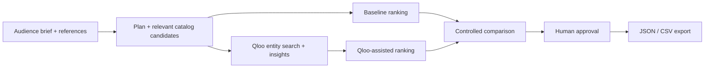

# CultMerch AI — Cultural Commerce Agent

Turn a cultural audience brief into an explainable merchandise collection under stock and gross-margin constraints.

Built for the [Qloo Agentic Hackathon](https://qloo.devpost.com/). Next.js 15.5.28, React 19, TypeScript, Tailwind, Zod. See `LICENSE` (MIT).

**Release status:** locally audited on 29 October 2026. Public application URL, public repository URL and a fresh live Qloo run remain to be verified. This source folder is not a deployed submission.

## What the agent does

1. Interprets an audience brief using local rules or optional Gemini.
2. Resolves named audience anchors and relevant catalog brands through Qloo `/search`.
3. Queries `/v2/insights` for cross-domain cultural signals and targeted brand affinities.
4. Filters the same catalog for both comparison branches, enforcing stock > 0 and the configured minimum gross margin (35% by default).
5. Ranks relevant candidates without Qloo in A and with scored Qloo evidence in B, preserving category diversity. Qloo contributes up to 25% of the internal ranking in the brief-profile path.
6. Requires human review before exporting a JSON manifest or CSV. This is a downloadable manifest, not a direct Shopify/ERP integration.



## Run locally

Use Node.js 22 or newer with npm. Install using the lockfile:

```bash
npm ci
cp .env.example .env.local
```

Set real keys **only in `.env.local`**, never in source or the browser, after checking access and cost. Qloo requests are server-side. Gemini is optional and is not required by the competition rules reviewed on 29 October.

```bash
npm run dev -- --hostname 127.0.0.1 --port 3107
```

Open http://127.0.0.1:3107. The UI is French with an expandable **English guide** on every screen; see `TESTING_EN.md` for a walkthrough.

For a development simulation with no provider credentials, override the local keys with empty environment values:

```bash
QLOO_API_KEY= GEMINI_API_KEY= GOOGLE_API_KEY= npm run dev -- --hostname 127.0.0.1 --port 3107
```

This runs `MOCK_SIMULATED`, not live Qloo. Do not enter nonempty example placeholders as credentials. Production requires a valid Qloo key unless simulation is explicitly permitted; do not publish a simulation as a verified Qloo application.

## Verification

With the development server above running, and provider keys empty in the test shell:

```bash
QLOO_API_KEY= GEMINI_API_KEY= GOOGLE_API_KEY= TEST_BASE_URL=http://127.0.0.1:3107 npm test
npx --no-install tsc --noEmit
npm run build
npm start -- --hostname 127.0.0.1 --port 3107
```

Stop the development server before building: both use `.next`. Browser tests currently expect Google Chrome at its standard macOS path. Test suites run serially because they share a temporary store. HTTP/browser tests use the server's configured provider mode; use a simulation server for no-cost tests.

The dedicated live integration test is **skipped** by default and does not read `.env.local`. It runs only with explicit `QLOO_LIVE_TESTS=1`; that opt-in can contact Qloo and must be authorized according to the account's costs. A missing key with live opt-in is an error, not a passing test.

## Provenance and limits

- `LIVE_QLOO`: fresh successful Qloo responses from the current execution.
- `CACHED_QLOO`: stored responses loaded later; original timestamps are retained.
- `MOCK_SIMULATED`: synthetic signals for development/testing.
- `MIXED_QLOO`: mixed or partially failed provenance.
- `NO_QLOO`: no usable Qloo data. Failures never inject synthetic affinities into a live run.

All 50 catalog products, prices, costs, inventory levels and product-to-brand associations are synthetic/editorial. Qloo supplies entity/affinity signals; CultMerch performs local matching to those products. The internal alignment/MAI scores are neither purchase probabilities nor independent quality measurements. Historical JSON reports marked live are archives, not proof that today's API works.

The store uses process memory and a shared local temporary file. **It is not a distributed database.** A single long-running Node server is the supported demonstration topology; persistence is lost on temporary-disk cleanup and concurrent processes are unsupported. The included historical Vercel configuration does not establish functional multi-instance deployment. See `DEPLOYMENT_EN.md` before hosting.

## Third-party tools

Next.js, React, Tailwind CSS, TypeScript, Zod, Lucide icons, tsx and Puppeteer are used under their respective upstream licenses; see the lockfile for exact versions. Qloo data/API access and optional Google Gemini remain governed by their provider terms. The MIT license covers project code, not third-party API data or brand ownership.

## Qloo data in public source

The [official hackathon guide](https://docs.qloo.com/reference/qloo-llm-hackathon-developer-guide#can-i-cache-qloo-api-responses-in-my-app) permits private server-side caching and prohibits storing Qloo response data in a public repository. Recorded evaluation responses, screenshots containing those records and private audit archives are excluded from the public source candidate. The cache-state tests use a clearly labeled synthetic fixture. Do not upload the entire original local project folder or its old ZIP archive.
